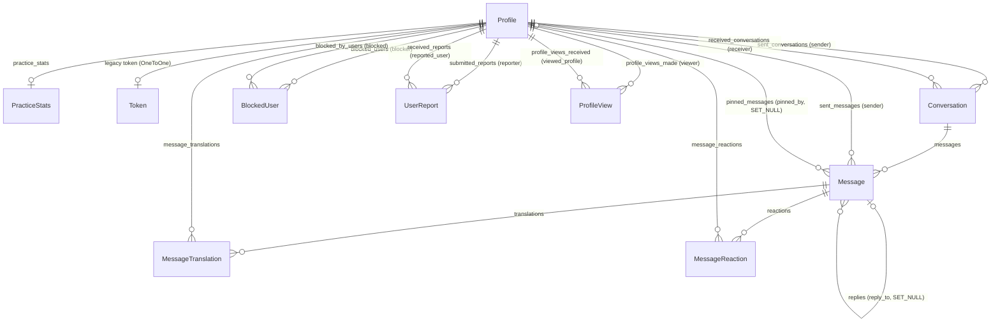

# Data model (backend/chatapp/models.py)

Purpose: the database schema plus the business rules that depend on it, so you don't have to re-read models/views/consumers.
**Verified at commit c1d44c5 (2026-10-26); updated in PRs `fix/reliability` and `fix/chat-races` (pending: practice scoring guard).** Latest migration: `0031_query_perf_indexes`.
Refresh: `git diff --stat c1d44c5..HEAD -- backend/chatapp/models.py backend/chatapp/migrations backend/chatapp/views.py backend/chatapp/consumers.py backend/chatapp/serializers.py backend/chatapp/storage.py backend/core/settings.py`. Re-read only the files that changed, then update this file and the commit line above.

DB: SQLite locally (`backend/db.sqlite3`); Postgres in production (`NEON_DATABASE_URL` or `DATABASE_URL`, psycopg3 pool, see caching.md). `AUTH_USER_MODEL = "chatapp.Profile"`, `TIME_ZONE = "UTC"`, `USE_TZ = True`. `admin.py` registers nothing.

## ER diagram

Every FK is `on_delete=CASCADE` except `Message.reply_to` and `Message.pinned_by` (SET_NULL). Deleting a Profile removes their conversations, messages, reactions, translations, blocks, reports and views.

## Models

### Profile (custom user, `AbstractBaseUser`; manager `ProfileManager`)
| Field | Type / constraints |
|---|---|
| username | Char(30), unique, db_index. Regex `^[\w.@+-]{1,30}$` is enforced in the views, not the model |
| email | Email(255), unique, null/blank. **`USERNAME_FIELD = "email"`**, `REQUIRED_FIELDS = ["username"]`; lowercased by register/edit/login |
| password | Char(128), null/blank (overrides the base field) |
| date_of_birth | Date, null. `age` is a computed property, not stored |
| native_language | Char(255), required (views cap it at 50) |
| base_translate_language | Char(50), default `"english"` (a language name; `resolve_language_code` maps it to an ISO code) |
| languages_practicing | JSON, default `[]`. List of language names. Clients send lowercase; the server only strips and caps them (at most 20 names, 50 chars each) |
| practice_language_levels | JSON, default `{}`. `{language_name: "beginner"\|"intermediate"\|"advanced"\|"fluent"}`. Keys must be in `languages_practicing`; anything else is silently dropped (`profile_edit_view`). The key lookup is case-sensitive (community `level` filter uses `practice_language_levels__<my_native_lower>`) |
| bio, learning_goal | Text, default `""` (views cap them at 2000) |
| location | Char(255), default `""`; location_updated_at DateTime, null |
| profile_image_url | Char(255), default `"profile_images/MainAfter.jpg"`. Holds a storage path, a `/media/...` URL or an absolute Cloudinary URL (see Media) |
| complementary_image_1_url / _2_url | Char(255), default `""` |
| avatar_ring_palette | Char(20) choices teal/blush/gold/lavender/slate, null. Legacy: the views use `avatar_ring_color` instead |
| avatar_ring_color | Char(7), default `"#1b7f79"`. Views require `#[0-9a-f]{6}` |
| is_online | Bool, default False, db_index |
| last_seen | DateTime, null |
| ws_connection_count | PositiveInt, default 0 |

Meta: index `profile_username_upper_idx` on `Upper("username")` (for `username__iexact`).
Manager: `create_user(username, password, **extra)` hashes the password. `create_superuser` (used by `manage.py createsuperuser`) lowercases the email and creates a **regular** account: there are no `is_staff` / `is_superuser` fields, so the Django admin stays unusable (it used to crash setting them).

### PracticeStats
`user` OneToOne→Profile (`practice_stats`), points / xp / correct_answers / total_answers PositiveInt default 0, level PositiveInt default 1, preferred_language Char(50) `""`, updated_at auto_now. Index `pstats_points_idx` on `-points`. Created lazily with `get_or_create` in the practice views.

### Token (legacy)
`user` OneToOne→Profile (no related_name, so the reverse accessor is `token`), key UUID unique, created_at. Only `login_view` (`/api/login/`) issues these. `CustomTokenAuthentication` (defined in models.py) **is not in `DEFAULT_AUTHENTICATION_CLASSES`**, so the issued tokens authenticate nothing. Dead code, slated for deletion.

### Conversation
`sender` FK→Profile (`sent_conversations`), `receiver` FK→Profile (`received_conversations`, **`default=1`**, legacy), created_at auto_now_add, updated_at auto_now.
`save()`: legacy fallback that sets the receiver to the user named `"alma"` if no receiver is set. Never hit in normal flows.
Indexes: `conv_sender_upd_idx` (sender, -updated_at), `conv_receiver_upd_idx` (receiver, -updated_at).

### Message
`conversation` FK (`messages`), `sender` FK→Profile (`sent_messages`), `reply_to` FK self (`replies`, SET_NULL), text Text (required by the model, can be `""` for attachment-only messages; views cap it at 5000), `attachment` FileField `upload_to="attachments/"` (null), status Char(10) choices sent/delivered/read, default `"sent"`, timestamp auto_now_add db_index, edited_at null, pinned_at null db_index, `pinned_by` FK→Profile (`pinned_messages`, SET_NULL).
`save()`: **only on create**, runs `Conversation.objects.filter(pk=...).update(updated_at=now)` and patches the cached `self.conversation` if one is loaded.
Indexes: `msg_conv_ts_idx` (conversation, -timestamp, -id); partial `msg_conv_unread_idx` (conversation, sender) WHERE status != 'read'; partial `msg_conv_pinned_idx` (conversation, -pinned_at) WHERE pinned_at IS NOT NULL.

### MessageTranslation
`message` FK (`translations`), `user` FK (`message_translations`), target_language Char(16) (ISO code), source_language Char(16) default `"auto"`, translated_text, created_at, updated_at.
Unique constraint `uniq_message_user_target_translation` (message, user, target_language). Written with `update_or_create` in `translate_message_view`. When the source language equals the target, the row stores the original text. `with_message_relations` prefetches the caller's rows for their `base_translate_language` code as `my_translations`.

### MessageReaction
`message` FK (`reactions`), `user` FK (`message_reactions`), emoji Char(16), created/updated. Unique constraint `uniq_message_user_reaction` (message, user): one reaction per user per message. An empty emoji deletes it. Allowed set: `ALLOWED_REACTION_EMOJIS` (6 emojis) in views.py.

### BlockedUser
`blocker` FK (`blocked_users`), `blocked` FK (`blocked_by_users`), created_at. Unique constraint `uniq_blocker_blocked_pair`.

### UserReport
`reporter` FK (`submitted_reports`), `reported_user` FK (`received_reports`), reason Char(64) (allow-list: spam, harassment, inappropriate_content, impersonation, scam, other; `other` requires details), details Text (capped at 2000), created_at. No uniqueness, so repeat reports are allowed (throttled 20/hour).

### ProfileView
`viewer` FK (`profile_views_made`), `viewed_profile` FK (`profile_views_received`), created_at, updated_at auto_now db_index.
Unique constraint `uniq_profile_view_pair`; index `pview_viewed_upd_idx` (viewed_profile, -updated_at); Meta `ordering = ["-updated_at"]`.

## Invariants and business rules
- **Conversation = an unordered pair.** There is no DB uniqueness on the pair (a unique index on least/greatest ids would fail on existing duplicates without a merge migration, so it was not added). `ConversationListView.post` runs get-or-create in `transaction.atomic()` after `select_for_update` on the lower-id participant's Profile row (serialises concurrent creates for the pair on Postgres; SQLite serialises writes anyway), matches `Q(sender=u, receiver=p) | Q(sender=p, receiver=u)` ordered by id, so legacy duplicates resolve to the oldest. "sender" just means "who started it". Participant check everywhere: `request.user.id in (sender_id, receiver_id)`, otherwise 403. The consumer checks with `get_participant_details`.
- That same `post` looks up the participant case-insensitively (`get_profile_by_username_or_404`), like every other username lookup.
- **Only Message creation bumps `Conversation.updated_at`** (`Message.save` on create). Edits, pins, status changes, reactions and deletes don't reorder the list. `Conversation.updated_at` also changes on `Conversation.save()` (auto_now), which only runs at creation. The list is ordered by `-updated_at, -id`.
- **Messages are only persisted over REST** (`MessageListView.post`, multipart), and the view broadcasts the saved message (`message_created`) to the chat room; deletes broadcast `message_deleted`. The consumer ignores client `chat`/`deleteMessage` frames, so nothing unsaved or unauthorised reaches other clients.
- **Status lifecycle sent → delivered → read** (it never goes backwards):
  - `delivered`: `mark_messages_delivered(qs, user)` marks the *recipient's* incoming `sent` messages. It's called on GET `/conversations/` (all of the user's conversations, before the cache check), GET `/conversations/<id>/` and GET `/conversations/<id>/messages/`. It broadcasts `message_status_event` per conversation and bumps both participants' list cache versions.
  - `read`: `mark_conversation_read_view` (PATCH) marks every non-read incoming message read (sent → read directly is allowed). It broadcasts `message_status_event` plus `conversation_update` (`messages_read`).
  - The unread count is a correlated subquery: incoming and status != read.
- **Blocking**: a `BlockedUser` row in *either* direction blocks the pair (`users_are_blocked`, `get_blocked_user_ids`, `get_block_state`). Enforced in:
  - the community list (both directions excluded)
  - `public_profile_view` (403 before recording a view)
  - `MessageListView.post` (403)
  - conversation creation (403)
  - presence contacts (`get_presence_contact_ids` excludes blocked pairs)

  `block_user_view` POST also **hard-deletes the pair's conversations (and their messages)**. Unblocking restores nothing. Already-open chat sockets aren't kicked out.
- **Case-insensitive usernames**: `get_profile_by_username_or_404` uses `iexact` and, if legacy case-variant duplicates exist, falls back to the lowest id. Register and edit reject `iexact` collisions. Email collisions are also checked with `iexact`.
- **ProfileView is update-then-create** (`record_profile_view`): UPDATE updated_at, else create in `atomic()`, catching IntegrityError on a race and retrying the update. Self-views are ignored. DB lock errors are swallowed. It bumps the viewed user's profile cache version only when the viewer wasn't already the most recent viewer. Profile payloads show the 12 most recent viewers.
- **PracticeStats are updated with F()** in `practice_submit_view`, at most once per served challenge (`practice:scored` cache guard, see caching.md): atomic increments; `level = (xp + awarded) / 100 + 1`, mirroring `practice_level_from_xp` (`xp // 100 + 1`). Buckets: level ≤2 → 1, ≤4 → 2, else 3. XP/points: correct +15/+10, wrong +3/+1. The leaderboard filters `preferred_language__iexact` and falls back to global.
- **Presence**:
  - `ws_connection_count` counts open sockets (chat and presence) per user. `increment_presence` / `decrement_presence` (consumers.py) use only atomic filtered UPDATEs, and the count never goes negative.
  - `is_online` turns True on the first socket and False when the last socket closes, which also sets `last_seen`.
  - The effective online state is `is_online AND last_seen >= now - ONLINE_FRESHNESS_SECONDS (90)`. This is checked in `ProfileSerializer.get_is_online` and `get_online_contact_ids`.
  - Heartbeats (~20 s) refresh `last_seen` at most every `PRESENCE_TOUCH_INTERVAL_SECONDS` (60).
  - `mark_presence_offline_view` (logout) zeroes the counters. The `reset_presence` command (run in the Procfile release phase) zeroes all counters.
- **JWT auth** (SimpleJWT: access 1 h, refresh 7 d, cookies `lv_access`/`lv_refresh`) doesn't touch any model. There is no token blacklist table.
- `load_dummy_data` is legacy: it creates `username="Alma"`, "John Doe", etc. with no email. Dev only.

## Media
- Fields: `Message.attachment` (FileField → `default_storage`, upload name forced to `<uuid4hex><ext>`). `Profile.profile_image_url` and `complementary_image_{1,2}_url` are **plain CharFields holding URLs or paths**, not FileFields.
- `STORAGES["default"]`: `chatapp.storage.CloudinaryMediaStorage` when `CLOUDINARY_URL` is set, otherwise `FileSystemStorage` (`MEDIA_ROOT = backend/media`, `MEDIA_URL = /media/`). `STORAGES["staticfiles"]`: `StaticFilesStorage` locally, otherwise whitenoise `CompressedManifestStaticFilesStorage` (`WHITENOISE_MANIFEST_STRICT = False`).
- `CloudinaryMediaStorage`: picks the resource type from the extension (`.mp4 .webm .mov .ogg .mp3 .wav .m4a .aac` → video, else image). It keeps the extension on the stored name so `_get_url` and `delete` can derive the type again.
- Profile image upload (`update_profile_image`, slot = profile|complementary_1|complementary_2): with Cloudinary it calls `cloudinary_upload(folder="profile_images")` directly and stores `secure_url` (absolute). Otherwise it uses `default_storage.save("profile_images/<uuid><ext>")` and stores `default_storage.url(path)` (e.g. `/media/profile_images/...`). `profile_edit_view` only accepts references to our own media or Cloudinary (`is_allowed_profile_image_reference`).
- URL building:
  - `build_media_url(request, path)` (views.py): absolute http(s) URLs pass through, upgraded to https for herokuapp.com / langvoyage.com. Otherwise it strips a `/media/` or `media/` prefix, does `request.build_absolute_uri(MEDIA_URL + path)`, and forces https when the request host is a production host.
  - `ProfileSerializer.get_profile_image_url` duplicates this logic.
  - `MessageSerializer.get_attachment_url` uses `attachment.url` made absolute, with the same https upgrade.
  - `moderation_summary_view` returns the raw `profile_image_url` (not built).
- `/media/` is served without auth (random filenames only).
